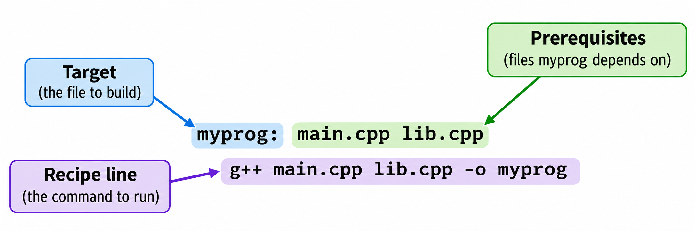
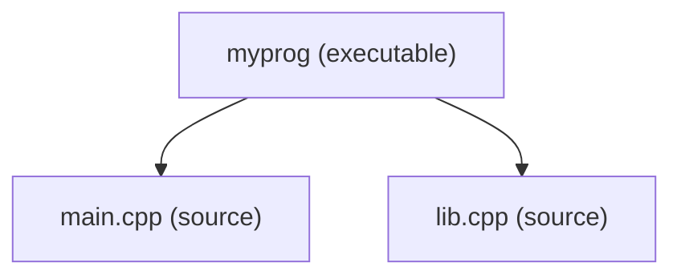

# GNU `make`

GNU Make is a build automation tool that reads instructions from a file called a `Makefile` and executes the commands needed to build your project. It is part of the GNU Project and is available on virtually every Unix-like system.

The key feature of `make` is **incremental building**: it tracks dependencies between files and only rebuilds what has changed. If you modify a single source file, `make` recompiles only that file (and anything that depends on it) instead of rebuilding the entire project. This makes builds significantly faster as projects grow.

## Example C++ Program

To see how `make` works in practice, consider the following C++ program:

    project/
    ├── lib.h
    ├── lib.cpp
    ├── main.cpp
    └── Makefile

```cpp
// lib.h

#ifndef HELPER_H
#define HELPER_H

void myPrintHelloMake(void);

#endif
```

```cpp
// lib.cpp

#include <iostream>
#include "lib.h"

void myPrintHelloMake(void)
{
  std::cout << "Hello makefiles! \n";
}
```

```cpp
// main.cpp

#include "lib.h"

int main()
{
  myPrintHelloMake();  // call a function in another file
  return 0;
}
```

Normally, you would compile this program by running:

    g++ main.cpp lib.cpp -o myprog

This compiles the two `.cpp` files and produces the executable `myprog`. A Makefile lets you automate this step.

## The Makefile

A `Makefile` is the configuration file that `make` reads. It defines **rules** that describe how to build each output file from its source files. Here is a Makefile for the program above:

```makefile
# Makefile

myprog: main.cpp lib.cpp
	g++ main.cpp lib.cpp -o myprog
```

## Anatomy of a Rule

The two lines above form one **rule**:



Each rule has three parts:

- **Target** — The output file to create (`myprog` in this example).
- **Prerequisites** — The input files required to build the target (`main.cpp` and `lib.cpp`). Also called *dependencies*.
- **Recipe** — One or more TAB-indented shell commands that build the target from its prerequisites. Also called *commands*.

The rule begins with the target name, followed by a colon (`:`) and the list of prerequisites. The recipe lines appear below, each indented with a TAB character.

## Invoking `make`

The general syntax for invoking `make` is:

    make [OPTIONS] [TARGETS]

If no target is specified, `make` executes the first target in the Makefile by default.

When invoked, `make` searches for one of the following filenames in the current directory, in this order:

1. `GNUmakefile`
2. `makefile`
3. `Makefile` (the most commonly used name)

If none of these files are found, `make` exits with an error:

    $ make
    make: *** No targets specified and no makefile found.  Stop.

You can specify a custom filename with the `-f` option:

    $ make -f customfile.mk

### Running the Example

With the Makefile in place, build the program by running:

    $ make

`make` prints the recipe it executes:

    g++ main.cpp lib.cpp -o myprog

If you run `make` a second time without changing any source files:

    $ make
    make: 'myprog' is up to date.

This means `make` checked the prerequisites and determined that nothing needs to be rebuilt.

## How `make` Detects Changes

`make` decides whether to rebuild a target by comparing the **modification time** (`mtime`) of the target file against its prerequisites:

- If the target does not exist, it must be built.
- If any prerequisite is newer than the target, the target must be rebuilt.
- If all prerequisites are older than the target, the target is up-to-date and `make` skips the recipe.

In the example above, `make` compares the `mtime` of `myprog` against `main.cpp` and `lib.cpp`. If either source file has been modified since `myprog` was last built, the recipe runs again.

## How `make` Executes

Unlike C/C++ or Python — where statements run sequentially from top to bottom — `make` is **declarative and dependency-driven**. You describe *what* depends on *what*, and `make` determines the order of execution automatically.

`make` processes a Makefile in two phases:

1. **Parsing** — `make` reads the entire Makefile and builds an internal **dependency graph** — a map of which targets depend on which prerequisites. No recipes are executed yet.

2. **Execution** — `make` walks the dependency graph, starting from the requested target and working backward through its prerequisites. It builds targets in the order dictated by the graph, not by the order the rules appear in the file.

With our single-rule Makefile, the dependency graph is straightforward:



`myprog` depends on `main.cpp` and `lib.cpp`. Both are source files with no prerequisites of their own — they are the leaves of the graph. If either is newer than `myprog`, the recipe runs.

## Recipe Prefix

Each recipe line must start with a **TAB character** (not spaces).

```makefile
all:
	echo "Building project"
```

If you mistakenly use spaces instead of a TAB, `make` reports an error:

    Makefile:2: *** missing separator.  Stop.

This is a common source of frustration because TABs and spaces look identical in many text editors. To avoid this, configure your editor to display whitespace characters, or use the `RECIPEPREFIX` variable.

`RECIPEPREFIX` (introduced in GNU Make 4.0) lets you replace the TAB requirement with a character of your choice. For example, using `>` as the recipe prefix:

```makefile
.RECIPEPREFIX := >

all:
>@echo "Hello world"
```

## Shell Instances and Command Execution

Each recipe line in a Makefile runs in its own **separate shell process**. Changes to the shell environment (such as changing directories or setting variables) are not preserved across lines.

For example, the following does **not** work as expected:

```makefile
example:
	cd mydir
	echo "Current directory is $$(pwd)"
```

The `cd mydir` runs in one shell, then `echo` runs in a new shell that starts back in the original directory. The directory change is lost.

> **Note:** `$$(pwd)` uses a double `$$` because `make` interprets a single `$` as a variable reference. The double `$$` escapes the dollar sign, passing a literal `$(pwd)` to the shell.

To fix this, combine the commands on a single line using `&&` or `;`:

```makefile
example:
	cd mydir && echo "Current directory is $$(pwd)"
```

```makefile
example:
	cd mydir; echo "Current directory is $$(pwd)"
```

The `&&` operator is preferred because it stops execution if the first command fails (e.g., if `mydir` does not exist). The `;` operator always runs both commands regardless of whether the first one succeeded.

---

← Previous: [Build Automation Tools](01_build_automation.md) · Next: [Separating Compile and Link](03_separating_compile_link.md) →
