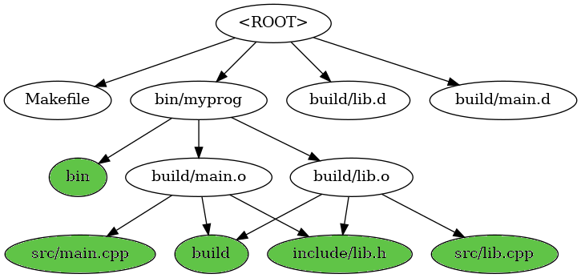

# Parallel Make

By default, Make executes one recipe at a time. On a machine with multiple CPU cores, this leaves most of the hardware idle. The `-j` (jobs) flag tells Make to run multiple independent recipes in parallel.

## Using `-j`

```
$ make -j4            # run up to 4 recipes in parallel
$ make -j$(nproc)     # one job per CPU core (nproc prints the core count)
$ make -j             # unlimited — as many as possible (use with caution)
```

### Load Limiting

On shared machines, unlimited parallelism can overload the system. The `-l` flag pauses new jobs when the system load average exceeds a threshold:

```
$ make -j8 -l 4.0
```

This allows up to 8 parallel jobs but holds off starting new ones if the load average exceeds 4.0.

## How It Works

Make builds a dependency graph from the Makefile and processes it bottom-up — starting with targets whose prerequisites are already satisfied. With `-j`, independent targets at the same level run in parallel.

Here is the dependency graph for our [ch16 Makefile](16_project_structure.md#the-makefile--project-structure):



Make starts by checking the leaf nodes — targets with no prerequisites of their own:

1. **Leaf nodes** — `src/main.cpp`, `src/lib.cpp`, and `include/lib.h` already exist on disk — nothing to do. `build/` and `bin/` also have no prerequisites but do not exist yet, so Make creates both (`mkdir -p`) in parallel.

2. **Compilation** — Once `build/` exists, `build/main.o` and `build/lib.o` can compile in parallel — neither depends on the other. (Both need `include/lib.h`, but a shared prerequisite does not create a dependency *between* them.)

3. **Linking** — Once both `.o` files and `bin/` are ready, Make links them into `bin/myprog`.

With `-j4`:

```
$ make -j4
mkdir -p build
mkdir -p bin
[CXX] src/main.cpp       ← both start at the same time
[CXX] src/lib.cpp        ←
[LINK] bin/myprog        ← waits for both .o files
```

Without `-j`, the same build runs sequentially:

```
$ make
mkdir -p build
mkdir -p bin
[CXX] src/main.cpp       ← finishes first
[CXX] src/lib.cpp        ← then starts
[LINK] bin/myprog
```

Make only parallelizes truly independent work — it always respects the dependency graph.

## When Parallelism Breaks

`make -j` only works correctly when the dependency graph is complete. If a dependency is missing, two recipes may run simultaneously when one actually needs the other's output:

```makefile
# Bug: missing dependency between generate and compile
all: generate compile

generate:
	./gen_config.sh > config.h

compile:
	$(CXX) -c main.cpp -o main.o    # needs config.h
```

`all` depends on both targets, so `make -j` starts them simultaneously. `compile` could begin before `config.h` exists. The fix is to declare the dependency:

```makefile
compile: generate
```

With sequential make (the default), you might never notice the bug because recipes happen to run in the order listed. This is why `make -j` is a good test of your dependency graph's correctness.

## Parallel Make with Recursive Make

When using `$(MAKE)` to invoke sub-makes (covered in [ch18](18_recursive_make.md)), the parent and child share a **job server** — a pool of tokens that limits the total number of parallel jobs across all make instances:

```makefile
modules:
	$(MAKE) -C src/module1
	$(MAKE) -C src/module2
```

With `make -j4`, the parent and sub-makes draw from the same pool of 4 tokens. You do **not** need to pass `-j` or `$(MAKEFLAGS)` explicitly — `$(MAKE)` handles this automatically.

> **Important:** Always use `$(MAKE)` for sub-makes, not bare `make`. Only `$(MAKE)` participates in the job server. A bare `make` call creates a separate process with no parallelism and triggers the warning: *"jobserver unavailable: using -j1."*

Note that the job server controls parallelism *within* each sub-make, but the two `$(MAKE) -C` calls above are still **sequential** — they are lines in a single recipe. This structural limitation is discussed in [ch18](18_recursive_make.md#1-reduced-parallelism).

---

← Previous: [Project Structure](16_project_structure.md) · Next: [Recursive Make](18_recursive_make.md) →
