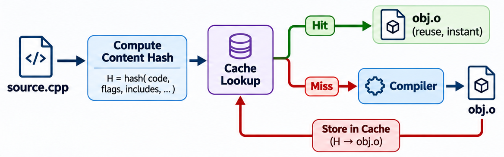

# Build Caching

Build caching stores the results of previous build steps so they can be reused later, skipping redundant work. The cache saves a mapping from **inputs** to **outputs** — when the same inputs are seen again, the cached output is returned instantly instead of rebuilding from scratch.

Build caching can operate at different levels, from individual source files up to entire packages:

| Level | What is cached | Tool | Scope |
|---|---|---|---|
| **Compiler-level** | Individual `.cpp` → `.o` compilations | ccache, sccache | Works with any build system (Make, CMake, Meson) |
| **Build-system-level** | Individual build actions (compile, link, generate) | SCons (`CacheDir`), Bazel | Built into the build system; supports shared and remote caching |
| **Task-level** | Individual build tasks within a recipe (compile, package, deploy) | Yocto sstate-cache | Per-task granularity; partial cache hits within a recipe |
| **Package-level** | Entire module → final `.deb`/`.rpm` package | Custom (e.g., SONiC dpkg cache) | All-or-nothing per module; caches the final artifact |

Compiler-level caching is the simplest to adopt — it requires no changes to your build system and works transparently. Build-system-level caching is more powerful but requires adopting that build system. Task-level and package-level caching are typically custom-built for large distribution builds.

The rest of this chapter focuses on **compiler-level caching**.

## Make's Built-in Approach: Timestamps

Make already avoids unnecessary work through **timestamp-based incremental rebuilds** — as covered in [ch02](02_gnu_make.md#how-make-detects-changes) and [ch03](03_separating_compile_link.md). If a source file has not changed since the last build, Make skips its recipe:

```
$ make
g++ -c main.cpp -o main.o
g++ -c lib.cpp -o lib.o
g++ main.o lib.o -o myprog

$ make
make: 'myprog' is up to date.
```

This works well for the most common case — editing a file and rebuilding in the same directory. However, timestamps have limitations:

| Scenario | What happens |
|---|---|
| `make clean && make` | All object files are deleted, everything recompiles from scratch |
| Switch git branches | Timestamps change, triggering unnecessary full rebuilds |
| Build on a different machine | No shared state — each machine builds everything from scratch |
| CI/CD pipeline | Every pipeline run starts clean — no reuse across runs |

In all of these cases, the source code hasn't changed, but Make's timestamp check doesn't help — the object files are gone. A **build cache** solves this by storing compiled results separately — outside the build directory — and retrieving them when the same inputs are compiled again.

## How Build Caching Works

A build cache operates on **content hashes** rather than timestamps:

1. Before compiling, the cache computes a hash of the inputs — source file contents, compiler flags, include paths, and headers.
2. If a cached object file with the same hash exists, it is returned immediately (**cache hit**).
3. If not, the compiler runs normally and the result is stored in the cache for future use (**cache miss**).



Because the cache uses content hashes, it works across `make clean`, branch switches, and even different machines — as long as the inputs are identical.

**Changes propagate through dependencies automatically.** If you modify `lib.h`, every source file that includes it produces a different hash — so all affected object files get a cache miss and are recompiled. Files that don't include `lib.h` still get cache hits. This is the same correctness guarantee Make provides through timestamp checking, but it survives `make clean` and branch switches.

## Compiler-Level Caching Tools

Several tools provide compiler-level caching for C/C++ projects:

| Tool | Description |
|---|---|
| **ccache** | The most widely used compiler cache. Wraps `gcc`/`g++`/`clang`. Local cache by default, supports remote storage. |
| **sccache** | Mozilla's shared compiler cache. Similar to ccache but designed for distributed/cloud caching (S3, GCS, Azure). |
| **distcc** | Distributes compilation across multiple machines. Not a cache, but complements ccache for parallel distributed builds. |

This chapter focuses on **ccache**, the standard choice for most projects.

## ccache

ccache (compiler cache) is a tool that sits between your build system and the compiler, caching compilation results transparently.

### Installation

```
$ sudo apt install ccache          # Debian/Ubuntu
$ sudo dnf install ccache          # Fedora
$ brew install ccache              # macOS
```

Verify:

```
$ ccache --version
ccache version 4.x
```

### How ccache Works

When Make runs a command like `g++ -c main.cpp -o main.o`, ccache intercepts the call and performs the content-hash lookup described [above](#how-build-caching-works). In addition to hashing the source file, headers, and compiler flags, ccache also includes the **compiler version** — so upgrading the compiler correctly invalidates stale cache entries.

### Cache Directory Structure

By default, ccache uses a **single global cache** shared across all projects compiled by the same user. The default location is `~/.cache/ccache/` on Linux and `~/Library/Caches/ccache/` on macOS. There is no per-project separation — cached object files from every project are stored together, identified only by their content hash. This means if two unrelated projects happen to compile the same source file with the same flags and compiler version, they share cache hits automatically.

To use a different cache location, override it with:

```
$ export CCACHE_DIR=/path/to/cache
```

The cache is organized as a multi-level directory tree, using hex characters from the content hash to spread files across subdirectories:

```
~/.cache/ccache/
├── 6/2/94kdaco8g0unb62ksj4a5gt8um1on3qR   ← result (cached object file)
├── 9/f/7dk7jl4i8rqi61ekkutb8anest7t728M   ← manifest (maps inputs to result)
├── c/5/d9ht0gc2n83qa9ptbsn12sok5qghhn4M
├── f/f/918lcftikcufgboakouue0qfq657mcoR
└── ...
```

ccache dynamically adjusts the directory depth between **2 and 4 levels**, targeting roughly 2,000 files per directory. A small cache starts with 2 levels (256 buckets, as shown above). As the cache grows and directories fill up, ccache automatically moves entries deeper — to 3 levels (4,096 buckets) or 4 levels (65,536 buckets). This keeps filesystem lookups fast regardless of cache size.

Each cached compilation produces two files, identified by their suffix:

| Suffix | File type | Contents |
|---|---|---|
| **M** (manifest) | Input map | Records which source files, headers, and compiler flags were used. ccache checks this first to determine if a cache hit is possible. |
| **R** (result) | Cached output | The compiled object file (compressed with zstd by default). On a cache hit, ccache decompresses this and copies it to the output path. |

**How a lookup works:**

1. ccache computes a hash from the compiler command and source file (e.g., `c5d9ht0g...`).
2. It navigates to directory `c/5/` and looks for a matching **manifest** file.
3. The manifest lists the headers and their content hashes at the time of compilation. ccache checks whether the current headers still match.
4. If they match → **cache hit** — ccache reads the corresponding **result** file, decompresses the object file, and writes it to the output path.
5. If not → **cache miss** — ccache runs the compiler, then stores a new manifest and result.

This two-step lookup (manifest then result) is called **direct mode** — the default in ccache 4.x. It avoids running the preprocessor on cache hits, making them very fast.

### Using ccache with Make

There are two ways to integrate ccache with Make:

**Method 1 — Override `CXX` on the command line:**

```
$ make CXX="ccache g++"
```

This tells Make to use `ccache g++` instead of `g++` for all compilation. No Makefile changes required.

**Method 2 — Set `CXX` in the Makefile:**

```makefile
CXX = ccache g++
CXXFLAGS = -Wall -O2

myprog: main.o lib.o
	$(CXX) main.o lib.o -o myprog

%.o: %.cpp
	$(CXX) $(CXXFLAGS) -c $< -o $@
```

Both methods work the same way — ccache receives the full compilation command and handles caching transparently.

### Example

A first build populates the cache:

```
$ make CXX="ccache g++"
ccache g++ -Wall -O2 -c main.cpp -o main.o
ccache g++ -Wall -O2 -c lib.cpp -o lib.o
ccache g++ main.o lib.o -o myprog
```

Clean and rebuild — ccache returns cached results instantly:

```
$ make clean
rm -f myprog *.o

$ make CXX="ccache g++"
ccache g++ -Wall -O2 -c main.cpp -o main.o
ccache g++ -Wall -O2 -c lib.cpp -o lib.o
ccache g++ main.o lib.o -o myprog
```

The output looks the same, but the second build is faster — ccache served the object files from cache instead of running the compiler.

### Viewing Cache Statistics

```
$ ccache -s
Summary:
  Hits:               2 /    4 (50.00 %)
    Direct:           2 /    4 (50.00 %)
    Preprocessed:     0 /    2 (0.00 %)
  Misses:             2
    Direct:           2
    Preprocessed:     2
  Uncacheable:        2
Primary storage:
  Hits:               4 /    8 (50.00 %)
  Misses:             4
  Cache size (GB): 0.00 / 5.00 (0.00 %)
```

- **Hits: 2 / 4** — 2 out of 4 cacheable compilations were served from cache (fast).
- **Misses: 2** — compilations that ran the compiler. These results are now cached for next time.
- **Uncacheable: 2** — operations ccache cannot cache, such as linking.

To reset statistics:

```
$ ccache -z
```

### Cache Management

```
$ ccache -C                        # clear the entire cache
$ ccache -M 5G                     # set maximum cache size to 5 GB
$ ccache --show-config             # display current configuration
```

### Shared Caching

By default, ccache stores its cache locally — only the current user benefits. For teams and CI pipelines, a **shared cache** lets multiple developers and build machines reuse each other's compiled results:

**1. Shared filesystem (NFS, mounted volume):**

```
$ export CCACHE_DIR=/shared/ccache
```

Every developer points `CCACHE_DIR` to the same network directory, so one developer's compilation becomes a cache hit for everyone else.

**2. CI pipeline pattern:**

A common pattern for CI/CD is:

1. The CI server stores its ccache directory as a **persistent volume** or **pipeline artifact** that survives across runs.
2. Each pipeline run starts by loading the cache from the previous run.
3. After building, the updated cache is saved for the next run.

This turns a full recompile on every CI run into a fast incremental build — only files that actually changed since the last run are recompiled.

**3. Cloud storage (sccache):**

For distributed teams, **sccache** supports storing the cache in cloud object storage (AWS S3, Google Cloud Storage, Azure Blob Storage). This eliminates the need for a shared filesystem:

```
$ export SCCACHE_BUCKET=my-build-cache
$ export SCCACHE_REGION=us-east-1
$ make CXX="sccache g++"
```

sccache talks to any **S3-compatible** storage, not just AWS. Self-hosted servers like **MinIO** work the same way — just point `SCCACHE_ENDPOINT` at your MinIO instance:

```
$ export SCCACHE_BUCKET=build-cache
$ export SCCACHE_ENDPOINT=http://minio.internal:9000
$ export SCCACHE_REGION=auto
```

For teams already using **JFrog Artifactory**, sccache can store cached objects via Artifactory's WebDAV interface (`SCCACHE_WEBDAV_ENDPOINT`), and ccache 4.13+ supports remote storage over HTTP (`CCACHE_REMOTE_STORAGE`). In both cases, the caching tool handles all the hash-based logic — the storage server simply stores and serves the cached object files.

### When Build Caching Helps Most

| Scenario                           | Without ccache             | With ccache |
|------------------------------------|----------------------------|---|
| `make clean && make`               | Full recompile             | Instant (cache hit) |
| Switch branches and build          | Partial or full recompile  | Instant for unchanged files |
| CI pipeline (warm cache)           | Full recompile every run   | Only recompile changed files |
| Multiple developers (shared cache) | Each rebuilds from scratch | Shared cache across the team |

Build caching is most valuable on **large projects** where full recompilation takes hours. For small projects with a few files, the benefit is minimal.

---

← Previous: [Platform Dependency](20_make_platform_dependency.md) · Next: [Autotools](22_autotools.md) →
