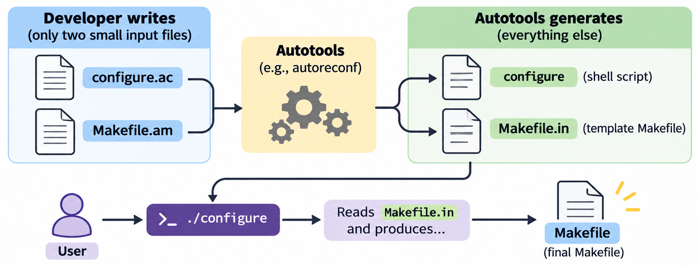
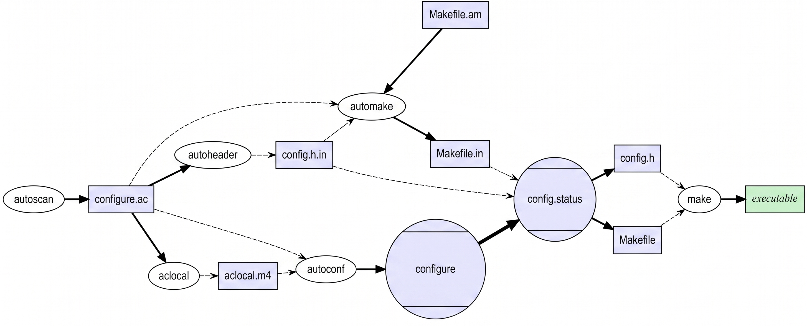

# Autotools

Autotools (the GNU Build System) is a suite of tools that automates building and installing software across different Unix-like systems. If you've ever built software from source with `./configure && make && make install`, you've used a project built with Autotools.

In [ch20](20_make_platform_dependency.md), we saw that Makefiles break across platforms — different compilers, flags, shell commands, and paths. Autotools solves this by generating a `configure` script that detects the local system's tools and capabilities, then produces a platform-correct Makefile automatically.

## History

Autoconf was created by David MacKenzie in 1991 to replace hand-written `configure` scripts that checked for system features. Automake followed in 1994, and Libtool in 1996. Together, these three tools form the core of Autotools. Despite its age, Autotools remains widely used. Notable projects include:

- **GCC** — the GNU Compiler Collection (C, C++, Fortran, and more)
- **GDB** — the GNU debugger
- **Binutils** — assembler, linker, and binary utilities (`as`, `ld`, `objdump`)
- **Tesseract OCR** — open-source optical character recognition engine
- **aria2** — lightweight multi-protocol download utility

## The User Workflow

When you download and build an Autotools project, you run three commands:

```
$ ./configure          # detect the system and generate a Makefile
$ make                 # build the project
$ make install         # install binaries and libraries
```

- **`./configure`** is a shell script (often thousands of lines long) that checks for compilers, libraries, headers, and system features. It produces a `Makefile` tailored to the local system.
- **`make`** builds the project using the generated Makefile.
- **`make install`** copies the built files to system directories (typically `/usr/local/`).

This is the most common build workflow in the Unix world.

### Common Configure Options

```
$ ./configure --help                     # list all options
$ ./configure --prefix=/opt/myapp        # install to a custom location
$ ./configure --enable-debug             # enable debug mode (project-specific)
$ ./configure --with-openssl=/usr/local  # specify a library location
```

## The Developer Workflow

The developer writes two small input files. Autotools generates everything else:



Then the user runs `./configure`, which reads `Makefile.in` and produces the final `Makefile`.

### `configure.ac`

The Autoconf input file — describes what to check for. It is written in **M4**, a macro processing language. Each `AC_` and `AM_` call is a macro that expands into shell script code during generation:

```m4
AC_INIT([myprog], [1.0])       # project name and version
AM_INIT_AUTOMAKE([foreign])    # enable Automake ('foreign' = skip GNU boilerplate)
AC_PROG_CXX                    # check for a C++ compiler
AC_CONFIG_FILES([Makefile])    # generate Makefile from Makefile.in
AC_OUTPUT                      # write the output files
```

The `foreign` option tells Automake not to require GNU-standard files like `NEWS`, `AUTHORS`, and `ChangeLog`.

### `Makefile.am`

The Automake input file — describes what to build:

```makefile
bin_PROGRAMS = myprog
myprog_SOURCES = main.cpp lib.cpp
```

That's it. `bin_PROGRAMS` means "build an executable and install it in `$(prefix)/bin`." Automake generates a full Makefile with compile rules, dependency tracking, `clean`, `install`, `uninstall`, and more — all from these two lines.

## Key Components

The developer only writes `configure.ac` and `Makefile.am`, but behind the scenes, `autoreconf -i` orchestrates several tools to produce the final `configure` script and `Makefile.in`:

| Component      | What it does                                                     |
| -------------- | ---------------------------------------------------------------- |
| **Autoscan**   | Scans source code and generates a starting `configure.ac` (optional, one-time use) |
| **Aclocal**    | Collects M4 macros needed by `configure.ac`                      |
| **Autoheader** | Generates `config.h.in` for preprocessor definitions             |
| **Autoconf**   | Generates the `configure` script from `configure.ac`             |
| **Automake**   | Generates `Makefile.in` templates from `Makefile.am`             |
| **Libtool**    | Handles building shared and static libraries portably            |
| **Autoreconf** | Runs all the above tools in the correct order                    |

The developer typically runs one command to generate everything:

```
$ autoreconf -i
```

The `-i` flag installs any missing auxiliary files (like `install-sh` and `missing`).

## Example

A minimal Autotools project:

```
project/
├── configure.ac
├── Makefile.am
├── main.cpp
└── lib.cpp
```

### Step 1 — Write the input files

`configure.ac`:

```m4
AC_INIT([myprog], [1.0])
AM_INIT_AUTOMAKE([foreign])
AC_PROG_CXX
AC_CONFIG_FILES([Makefile])
AC_OUTPUT
```

`Makefile.am`:

```makefile
bin_PROGRAMS = myprog
myprog_SOURCES = main.cpp lib.cpp
```

### Step 2 — Generate the build system

```
$ autoreconf -i
```

This creates `configure`, `Makefile.in`, and several helper files.

### Step 3 — Build

```
$ ./configure
$ make
$ ./myprog
Hello from lib!
```

### What Gets Generated

After `autoreconf -i`:

```
project/
├── configure.ac        ← developer wrote this
├── Makefile.am         ← developer wrote this
├── main.cpp
├── lib.cpp
├── configure           ← generated (shell script)
├── Makefile.in         ← generated (template)
├── aclocal.m4          ← generated (collected macros)
├── install-sh          ← generated (portable install)
├── missing             ← generated (handles missing tools)
└── ...
```

After `./configure`:

```
project/
├── Makefile            ← generated from Makefile.in
├── config.status       ← records the configure options used
├── config.log          ← detailed log of all configure checks
└── ...
```

## Order of Invocations

The full Autotools pipeline, from source to executable:




## Limitations

Autotools is powerful but has well-known drawbacks:

- **Unix-only** — designed for Unix-like systems. Windows support is poor without MSYS2 or Cygwin.
- **Steep learning curve** — `configure.ac` uses M4 macros, which have unfamiliar syntax.
- **Slow configure step** — the generated `configure` script runs hundreds of shell checks sequentially, which can take minutes on large projects.
- **Cryptic errors** — when something goes wrong in `configure.ac`, error messages often point to generated code, not the source.

For new projects, **CMake** ([ch23](23_cmake.md)) and **Meson** ([ch27](27_meson.md)) are more common choices. However, understanding Autotools is valuable — many existing projects use it, and the `./configure && make && make install` workflow isn't going away.

---

← Previous: [Build Caching](21_build_caching.md) · Next: [CMake](23_cmake.md) →
