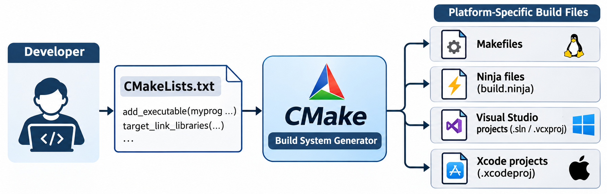

# CMake

CMake is an open-source, cross-platform **build system generator**. It generates platform-specific build files — Makefiles, Ninja files, Visual Studio projects, or Xcode projects — from a single `CMakeLists.txt` description. The developer describes *what* to build; CMake figures out *how*.



The name stands for "cross-platform make." CMake was first released in 2000 by Kitware. Notable projects that use CMake include:

- **LLVM/Clang** — compiler infrastructure and C/C++/Objective-C compiler
- **PyTorch** — machine learning framework
- **OpenCV** — computer vision library
- **Qt 6** — cross-platform GUI framework
- **KeePassXC** — open-source password manager

## CMake vs Autotools

Both CMake and Autotools ([ch21](21_autotools.md)) solve the same problem — portable builds across platforms. The key differences:

| Aspect           | Autotools                          | CMake                                       |
| ---------------- | ---------------------------------- | ------------------------------------------- |
| Platforms        | Unix-like only                     | Linux, macOS, Windows, and more             |
| Input file       | `configure.ac` (M4 macros)         | `CMakeLists.txt` (custom DSL)               |
| Generates        | `configure` script → Makefile      | Makefiles, Ninja, VS projects, Xcode, etc.  |
| Learning curve   | Steep (M4, shell scripting)        | Moderate (simpler syntax)                   |
| IDE integration  | Limited                            | Strong (Visual Studio, CLion, Qt Creator)   |

CMake is the preferred choice for most new projects. Autotools remains common in legacy GNU projects.

## Basic Example

A simple project:

```
project/
├── CMakeLists.txt
├── main.cpp
├── lib.cpp
└── lib.h
```

```cpp
// lib.h
#ifndef LIB_H
#define LIB_H
void hello_from_lib();
#endif
```

```cpp
// lib.cpp
#include <iostream>
#include "lib.h"

void hello_from_lib()
{
    std::cout << "Hello from lib!" << std::endl;
}
```

```cpp
// main.cpp
#include "lib.h"

int main()
{
    hello_from_lib();
    return 0;
}
```

```cmake
# CMakeLists.txt
cmake_minimum_required(VERSION 3.10)
project(MyProject)
add_executable(myprog main.cpp lib.cpp)
```

Three lines:
- **`cmake_minimum_required`** — the minimum CMake version required.
- **`project`** — names the project (also used in IDE project files).
- **`add_executable`** — defines a build target and its source files.

Note that all source files are listed in a single `add_executable`. This compiles `main.cpp` and `lib.cpp` together and links them into one executable. Simple and sufficient for small projects. The alternative is the **library approach** — build the library separately, then link it:

```cmake
# CMakeLists.txt
add_library(mylib STATIC lib.cpp)
add_executable(myprog main.cpp)
target_link_libraries(myprog PRIVATE mylib)
```

This compiles `lib.cpp` into a static library (`libmylib.a`), compiles `main.cpp` separately, then links the two together. Use this when the library is shared by multiple targets (e.g., the main program and a test program both use `mylib`).

Both approaches produce the same executable. The library approach is covered in the [Static Library](#static-library) section below.

### Building

CMake uses an **out-of-source build** — generated files go in a separate directory, keeping the source tree clean:

```
$ cmake -S . -B build        # generate build files
$ cmake --build build        # compile the project
$ ./build/myprog             # run the executable
```

- **`-S .`** — source directory (where `CMakeLists.txt` is).
- **`-B build`** — build directory (created automatically).
- **`cmake --build build`** — invokes the underlying build tool (Make, Ninja, etc.).

## Build Generators

CMake can generate files for different build systems. The default on Linux is Unix Makefiles:

```
$ cmake -S . -B build -G "Ninja"          # use Ninja instead of Make
$ cmake -S . -B build -G "Unix Makefiles" # explicitly use Make (default on Linux)
```

Common generators:

| Generator            | Output                                     |
| -------------------- | ------------------------------------------ |
| `Unix Makefiles`     | Standard Makefiles (default on Linux)      |
| `Ninja`              | `build.ninja` files (fast parallel builds) |
| `Visual Studio 17`   | `.sln` and `.vcxproj` files                |
| `Xcode`              | Xcode project files                        |

Run `cmake --help` to see all available generators on your system.

## Header Dependency Tracking

CMake automatically tracks header dependencies — you do not need to list headers in `CMakeLists.txt`:

```
$ cmake --build build
[100%] Built target myprog

$ touch lib.h                     # modify the header

$ cmake --build build
[ 33%] Building CXX object CMakeFiles/myprog.dir/main.cpp.o
[ 66%] Building CXX object CMakeFiles/myprog.dir/lib.cpp.o
[100%] Linking CXX executable myprog
```

Only the affected source files are recompiled. CMake handles dependency files internally, similar to the `-MMD -MP` flags we added manually in [ch09](09_header_file_dependencies.md).

## Project Structure

For projects with separate `src/` and `include/` directories:

```
project/
├── CMakeLists.txt
├── include/
│   └── lib.h
└── src/
    ├── main.cpp
    └── lib.cpp
```

```cmake
cmake_minimum_required(VERSION 3.10)
project(MyProject)

add_executable(myprog src/main.cpp src/lib.cpp)
target_include_directories(myprog PRIVATE include)
```

**`target_include_directories`** tells the compiler where to find header files — equivalent to `-Iinclude` in our Makefiles. The `PRIVATE` keyword means this include path applies only to this target.

> **Note:** Older CMake code uses `include_directories(include)`, which sets the include path globally. Modern CMake prefers `target_include_directories` because it keeps dependencies explicit per target.

Build:

```
$ cmake -S . -B build
$ cmake --build build
$ ./build/myprog
```

## Static Library

CMake builds static libraries with `add_library`:

```cmake
cmake_minimum_required(VERSION 3.10)
project(MyProject)

# Build a static library from lib.cpp
add_library(mylib STATIC src/lib.cpp)
target_include_directories(mylib PUBLIC include)

# Build the executable
add_executable(myprog src/main.cpp)

# Link the library to the executable
target_link_libraries(myprog PRIVATE mylib)
```

- **`add_library(mylib STATIC ...)`** — builds `libmylib.a`.
- **`PUBLIC`** on include directories — any target that links to `mylib` inherits its include paths.
- **`target_link_libraries`** — links the library to the executable.

Change `STATIC` to `SHARED` to build a shared library (`libmylib.so`) instead.

## External Libraries (`find_package`)

To use a library installed on the system, CMake provides `find_package()`:

```cmake
cmake_minimum_required(VERSION 3.10)
project(ExampleApp CXX)

find_package(OpenSSL REQUIRED)

add_executable(myprog main.cpp)
target_link_libraries(myprog OpenSSL::SSL OpenSSL::Crypto)
```

`find_package(OpenSSL REQUIRED)` searches for OpenSSL on the system. If found, it creates **imported targets** (`OpenSSL::SSL`, `OpenSSL::Crypto`) that automatically provide the correct include paths and link flags. If not found, CMake stops with an error:

```
CMake Error: Could NOT find OpenSSL
```

Install missing libraries with your system package manager:

```
$ sudo apt install libssl-dev      # Debian/Ubuntu
$ sudo dnf install openssl-devel   # Fedora/RHEL
$ brew install openssl             # macOS
```

## Conan and CMake

For libraries not available through system package managers, **Conan** ([ch14](14_package_managers.md)) integrates with CMake via toolchain files.

`conanfile.txt` — declare the dependency:

```ini
[requires]
poco/1.12.4

[generators]
CMakeToolchain
CMakeDeps
```

Install the dependency:

```
$ conan install . --build=missing --output-folder=build
```

`CMakeLists.txt` — include the Conan toolchain, then use `find_package` as usual:

```cmake
cmake_minimum_required(VERSION 3.15)
project(myProject)

set(CMAKE_CXX_STANDARD 17)

include(${CMAKE_BINARY_DIR}/conan_toolchain.cmake)

find_package(Poco REQUIRED)

add_executable(myprog main.cpp)
target_link_libraries(myprog Poco::Net Poco::Foundation)
```

Build:

```
$ cd build
$ cmake .. -DCMAKE_BUILD_TYPE=Release
$ cmake --build .
```

Conan provides the `find_package()` modules, so the CMakeLists.txt follows the same pattern as any system library — only the installation step differs.

## Subdirectories (`add_subdirectory`)

Large projects split CMake configuration across directories, similar to recursive Make ([ch18](18_recursive_make.md)):

```
project/
├── CMakeLists.txt
├── src/
│   └── main.cpp
└── mylib/
    ├── CMakeLists.txt
    ├── mylib.h
    └── mylib.cpp
```

**Top-level `CMakeLists.txt`:**

```cmake
cmake_minimum_required(VERSION 3.10)
project(MyApp)

add_subdirectory(mylib)

add_executable(myprog src/main.cpp)
target_link_libraries(myprog mylib)
```

**`mylib/CMakeLists.txt`:**

```cmake
add_library(mylib mylib.cpp)
target_include_directories(mylib PUBLIC ${CMAKE_CURRENT_SOURCE_DIR})
```

Unlike recursive Make, CMake builds a **single unified dependency graph** across all subdirectories — cross-directory dependencies are tracked correctly and parallel builds work fully.

## Compilation Database

CMake can generate a `compile_commands.json` file that describes how each source file is compiled. IDEs, linters, and analysis tools (like `clang-tidy` and `clangd`) use this for code intelligence:

```
$ cmake -S . -B build -DCMAKE_EXPORT_COMPILE_COMMANDS=ON
```

Or set it in `CMakeLists.txt`:

```cmake
set(CMAKE_EXPORT_COMPILE_COMMANDS ON)
```

The generated file contains one entry per source file:

```json
[
  {
    "directory": "/path/to/build",
    "command": "g++ -Iinclude -c src/main.cpp -o main.o",
    "file": "src/main.cpp"
  }
]
```

## Help Target

When using Unix Makefiles or Ninja, CMake generates a `help` target that lists all available build targets:

```
$ cmake --build build --target help

The following are some of the valid targets for this Makefile:
... all (the default if no target is provided)
... clean
... myprog
... mylib
```

---

← Previous: [Autotools](21_autotools.md) · Next: [SCons](23_scons.md) →
