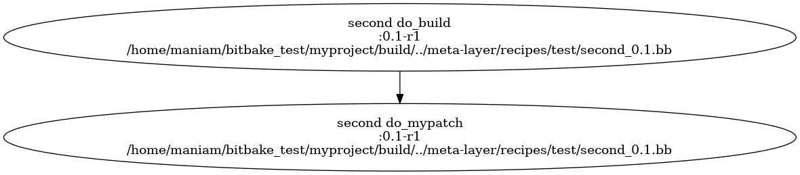

# BitBake

BitBake is a task execution engine primarily used for building custom Linux distributions for embedded systems. It processes **recipes** — metadata files that describe how to fetch, configure, compile, and package software — and executes them in dependency order.

BitBake was originally developed as part of the OpenEmbedded project in 2003, inspired by Gentoo Linux's Portage package manager. It became the foundation of the **Yocto Project** in 2010, which standardized embedded Linux development. Notable projects that use BitBake include:

- **Yocto Project** — embedded Linux distribution builder
- **Automotive Grade Linux** — Linux-based automotive platform
- **OpenBMC** — open-source baseboard management controller firmware
- **webOS** — LG's smart TV operating system

## Key Concepts

| Concept                           | Description                                                                     |
| --------------------------------- | ------------------------------------------------------------------------------- |
| **Recipes** (`.bb` files)         | Define how to build a package — source location, dependencies, compile steps    |
| **Classes** (`.bbclass` files)    | Reusable code that recipes can inherit to avoid duplication                     |
| **Configuration** (`.conf` files) | Global and machine-specific settings that control the build                     |
| **Layers**                        | Organizational units that group related recipes, classes, and configuration     |
| **Tasks**                         | Individual build steps (`do_fetch`, `do_compile`, `do_install`, etc.)           |
| **Appends** (`.bbappend` files)   | Extend or modify existing recipes without altering the original                 |

For the full reference, see the [BitBake User Manual](https://docs.yoctoproject.org/bitbake/bitbake-user-manual/bitbake-user-manual-intro.html).

## Installing BitBake

Clone or download from the [BitBake GitHub repository](https://github.com/openembedded/bitbake):

```
$ git clone https://github.com/openembedded/bitbake.git
$ cd bitbake
$ export PATH=$PWD/bin:$PATH
$ export PYTHONPATH=$PWD/lib:$PYTHONPATH
```

Verify:

```
$ bitbake --version
BitBake Build Tool Core version 2.9.1
```

## Minimal Configuration

A minimal BitBake project has this structure:

```
myproject/
├── build/
│   └── conf/
│       └── bblayers.conf
└── meta-layer/
    ├── conf/
    │   ├── bitbake.conf
    │   └── layer.conf
    ├── classes/
    │   └── base.bbclass
    └── recipes/
```

### `build/conf/bblayers.conf`

Tells BitBake which layers to include:

```
BBLAYERS = "${TOPDIR}/../meta-layer"
BBPATH := "${TOPDIR}"
BBFILES ?= ""
```

### `meta-layer/conf/layer.conf`

Defines paths for this layer:

```
BBPATH .= ":${LAYERDIR}"
BBFILES += "${LAYERDIR}/recipes/*/*.bb"
```

### `meta-layer/conf/bitbake.conf`

Core configuration — defines paths for temporary files, work directories, and build outputs. Copy this from the BitBake installation directory (`bitbake/conf/bitbake.conf`) as a starting point.

### `meta-layer/classes/base.bbclass`

Provides core build functionality. Copy from the BitBake installation (`bitbake/classes/base.bbclass`). Recipes inherit this class by default.

### Running

From the `build/` directory:

```
$ bitbake -vDDD world
```

- **`-v`** — verbose output.
- **`-DDD`** — debug level 3 (maximum detail).
- **`world`** — build all available recipes.

Since there are no recipes yet, nothing happens. Verify with:

```
$ bitbake -s

Recipe Name       Latest Version    Preferred Version    Required Version
===========       ==============    =================    ================
```

## First Recipe

Add a recipe to `meta-layer/recipes/test/`:

```
└── recipes/
    └── test/
        └── first_0.1.bb
```

Recipe files follow the naming convention `{name}_{version}.bb`.

```
# first_0.1.bb
DESCRIPTION = "I am the first recipe"
PR = "r1"

do_build () {
    echo "first: some shell script running as build"
}
```

- **`DESCRIPTION`** — human-readable description of the recipe.
- **`PR`** (Package Revision) — tracks recipe revisions (`r1`, `r2`, ...). Increment when making non-version changes to force rebuilds.
- **`do_build`** — a task (function prefixed with `do_`). This overrides the empty default `do_build` from `base.bbclass`.

List available recipes:

```
$ bitbake -s

Recipe Name       Latest Version    Preferred Version    Required Version
===========       ==============    =================    ================
first             :0.1-r1
```

Build it:

```
$ bitbake first
```

BitBake creates a `tmp/work/` directory containing logs for each task. The build output is at:

```
build/tmp/work/first-0.1-r1/temp/log.do_build
```

## BitBake Variables

To display all variables and metadata for a recipe:

```
$ bitbake -e first
```

Key variables:

| Variable    | Description                                            | Example Value                            |
| ----------- | ------------------------------------------------------ | ---------------------------------------- |
| `PN`        | Package name                                           | `first`                                  |
| `PV`        | Package version                                        | `0.1`                                    |
| `PR`        | Package revision                                       | `r1`                                     |
| `PF`        | Full package name (`PN-PV-PR`)                         | `first-0.1-r1`                           |
| `TOPDIR`    | Top-level build directory                              | `.../myproject/build`                    |
| `TMPDIR`    | Temporary build directory                              | `${TOPDIR}/tmp`                          |
| `WORKDIR`   | Working directory for the recipe                       | `${TMPDIR}/work/${PF}`                   |
| `S`         | Source directory                                       | `${WORKDIR}/${P}`                        |
| `B`         | Build directory                                        | `${S}`                                   |
| `T`         | Temp directory for task logs                           | `${WORKDIR}/temp`                        |
| `DL_DIR`    | Directory for downloaded source files                  | `${TMPDIR}/downloads`                    |
| `DEPLOY_DIR`| Directory for built artifacts                          | `${TMPDIR}/deploy`                       |
| `SRC_URI`   | URI for source code or resources                       | `file://hello.cpp`                       |
| `DEPENDS`   | Build-time dependencies                                | `openssl zlib`                           |

Full variable reference: [BitBake Variables Glossary](https://docs.yoctoproject.org/bitbake/bitbake-user-manual/bitbake-user-manual-ref-variables.html).

## Variable Assignments

BitBake provides several assignment operators:

| Operator   | Name                 | Description                                                              | Example                          |
| ---------- | -------------------- | ------------------------------------------------------------------------ | -------------------------------- |
| `=`        | Direct               | Sets the variable unconditionally                                        | `MY_VAR = "value"`               |
| `:=`       | Immediate            | Resolves references at parse time                                        | `MY_VAR := "${OTHER_VAR}-ext"`   |
| `?=`       | Weak (default)       | Assigns only if the variable is not already set                          | `MY_VAR ?= "default"`            |
| `??=`      | Weakest              | Assigns only if the variable is completely undefined                     | `MY_VAR ??= "fallback"`          |
| `+=`       | Append (with space)  | Appends to the value, separated by a space                               | `MY_VAR += "extra"`              |
| `=+`       | Prepend (with space) | Prepends to the value, separated by a space                              | `MY_VAR =+ "prefix"`            |
| `:append`  | Deferred append      | Appends after all assignments are processed                              | `MY_VAR:append = " appended"`    |
| `:prepend` | Deferred prepend     | Prepends after all assignments are processed                             | `MY_VAR:prepend = "prepended "`  |
| `:remove`  | Remove               | Removes a value from the variable                                        | `MY_VAR:remove = "unwanted"`     |

> **Note:** The older `_append`, `_prepend`, and `_remove` syntax (with underscore) was replaced by `:append`, `:prepend`, and `:remove` (with colon) in BitBake 2.0 / Yocto 3.4 (Honister). Both forms may appear in existing code.

## Task Dependencies

Tasks can depend on other tasks, ensuring proper execution order. The `addtask` directive defines these relationships.

Add a second recipe `second_0.1.bb`:

```
# second_0.1.bb
DESCRIPTION = "I am the second recipe"
PR = "r1"

do_mypatch () {
    echo "second: patching files before the build"
}

addtask do_mypatch before do_build
```

`addtask do_mypatch before do_build` tells BitBake that `do_mypatch` must complete before `do_build` starts.

View the task order:

```
$ bitbake -c listtasks second

do_mypatch
do_showdata
do_build
do_listtasks
```

Generate a dependency graph:

```
$ bitbake -g second
$ dot -Tpng -o task-depends.png task-depends.dot
```



The arrow means "depends on" — `do_build` depends on `do_mypatch`, so `do_mypatch` runs first.

### Standard Tasks

BitBake defines a standard task pipeline for building software:

| Task              | Description                                                                  |
| ----------------- | ---------------------------------------------------------------------------- |
| **`do_fetch`**    | Downloads source files from URLs specified in `SRC_URI`                      |
| **`do_unpack`**   | Extracts fetched archives into the work directory                            |
| **`do_patch`**    | Applies patches specified in `SRC_URI`                                       |
| **`do_configure`**| Runs configuration tools (`autoconf`, `cmake`, etc.)                         |
| **`do_compile`**  | Compiles source code into binaries                                           |
| **`do_install`**  | Installs compiled files into a staging area (`${D}`) for packaging           |
| **`do_package`**  | Creates binary packages (`.ipk`, `.rpm`, `.deb`) from staged files           |
| **`do_build`**    | Meta-task that triggers all of the above in order                            |

## Classes

A class (`.bbclass`) defines reusable tasks and functions that recipes can inherit. Add a custom class:

```
meta-layer/
├── classes/
│   ├── base.bbclass
│   └── mybuild.bbclass
└── recipes/
    └── test/
        └── third_0.1.bb
```

**`mybuild.bbclass`:**

```
addtask do_build
mybuild_do_build () {
    echo "running mybuild_do_build."
}

EXPORT_FUNCTIONS do_build
```

- The function is named `mybuild_do_build` (class name + task name).
- `EXPORT_FUNCTIONS do_build` makes it available to any recipe that inherits this class.

**`third_0.1.bb`:**

```
DESCRIPTION = "I am the third recipe"
PR = "r1"

inherit mybuild

python do_mypatch () {
    bb.note("running mypatch")
}

addtask mypatch before do_build
```

- **`inherit mybuild`** — imports the `do_build` task from `mybuild.bbclass`.
- **`python do_mypatch()`** — a Python task (instead of shell). Python tasks use `bb.note()` for logging.
- **`addtask mypatch before do_build`** — runs the patch task before building.

```
$ bitbake third
```

## Compiling a C++ Program

A practical recipe that compiles a C++ program:

```
└── recipes/
    └── example/
        ├── example_1.0.bb
        └── files/
            └── hello.cpp
```

```cpp
// hello.cpp
#include <iostream>

int main()
{
    std::cout << "Hello BitBake!" << std::endl;
    return 0;
}
```

```
# example_1.0.bb
SUMMARY = "Simple Example Application"
DESCRIPTION = "Compiles a C++ program with BitBake."

SRC_URI = "file://hello.cpp"

CC = "g++"
CFLAGS = "-O2 -Wall"

do_compile() {
    ${CC} ${CFLAGS} -c ${FILE_DIRNAME}/files/hello.cpp -o ${T}/hello.o
    ${CC} ${T}/hello.o -o ${T}/hello
}

do_install() {
    :
}

addtask compile before do_build
addtask install after do_compile before do_build
```

- **`SRC_URI`** — tells BitBake where to find source files.
- **`do_compile`** — compiles and links the program.
- **`do_install`** — empty (`:` is a shell no-op to prevent syntax errors). In a real recipe, this would copy the binary to `${D}`.
- **`addtask`** — defines the execution order: compile → install → build.

Build:

```
$ bitbake example
```

---

← Previous: [SCons](24_scons.md) · Next: [Ninja](26_ninja.md) →
