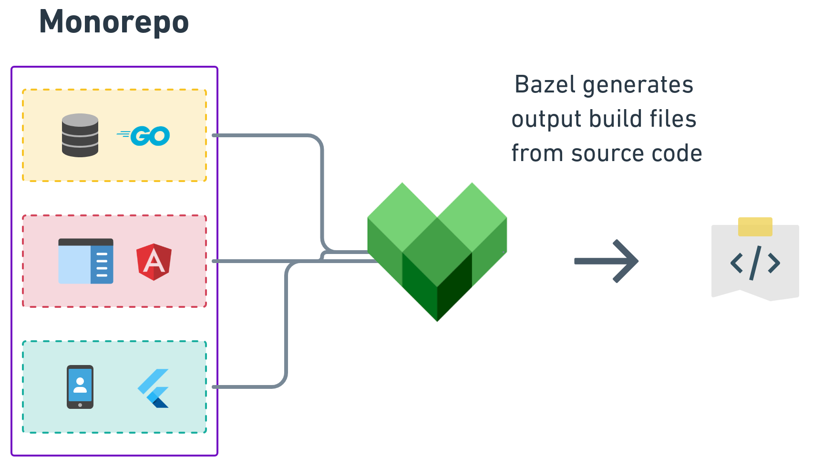

# Bazel

Bazel is a fast, scalable build system designed for large, multi-language **monorepos** — single repositories that contain the code for many projects, services, and libraries in one place. Companies like Google (~2 billion lines of code in one repo), Meta, and Microsoft use this approach at massive scale. Bazel was built to handle that scale efficiently.



Bazel emphasizes **reproducible, hermetic builds** — the same source code always produces the same output, regardless of the machine. The developer describes *what* to build in `BUILD` files using a Python-like language called **Starlark**; Bazel figures out *how*.

Bazel was originally developed internally at Google as **Blaze** and open-sourced in 2015. The name "Bazel" is an anagram of "Blaze." Notable projects that use Bazel include:

- **TensorFlow** — machine learning framework
- **Abseil** — Google's C++ common libraries
- **Envoy** — cloud-native proxy (service mesh)
- **Angular** — web application framework
- **Protocol Buffers** — language-neutral data serialization

## Bazel vs CMake

Both Bazel and CMake ([ch23](23_cmake.md)) build C/C++ projects, but they take very different approaches:

| Aspect             | CMake                                    | Bazel                                      |
| ------------------ | ---------------------------------------- | ------------------------------------------ |
| Type               | Build system generator                   | Build system (executes builds directly)    |
| Build files        | `CMakeLists.txt` (one per project/dir)   | `BUILD` (one per package/directory)        |
| Language           | Custom DSL                               | Starlark (Python-like)                     |
| Reproducibility    | Depends on environment                   | Hermetic (sandboxed, reproducible)         |
| Multi-language     | Primarily C/C++                          | C++, Java, Python, Go, and more            |
| Caching            | Local incremental rebuilds               | Local and remote build caching             |
| Learning curve     | Moderate                                 | Steep (more concepts to learn)             |

CMake is simpler for small to medium C/C++ projects. Bazel excels at large monorepos with multiple languages and teams.

## Key Concepts

| Concept            | Description                                                                   |
| ------------------ | ----------------------------------------------------------------------------- |
| **Workspace**      | The project root, marked by a `MODULE.bazel` file                             |
| **Package**        | A directory containing a `BUILD` file                                         |
| **Target**         | A buildable unit defined in a `BUILD` file (binary, library, test)            |
| **Rule**           | A function that defines how to build a target (`cc_binary`, `cc_library`)     |
| **Label**          | A unique identifier for a target: `//package:target`                          |
| **Starlark**       | The Python-like language used in `BUILD` and `.bzl` files                     |
| **Hermetic build** | A build that depends only on declared inputs, not the host environment        |

## Installation

Install Bazelisk, the recommended Bazel launcher. It automatically downloads the correct Bazel version for your project:

```
$ npm install -g @bazel/bazelisk    # via npm
$ brew install bazelisk             # macOS
$ go install github.com/bazelbuild/bazelisk@latest  # via Go
```

On Linux, you can also download the binary directly:

```
$ sudo curl -Lo /usr/local/bin/bazel https://github.com/bazelbuild/bazelisk/releases/latest/download/bazelisk-linux-amd64
$ sudo chmod +x /usr/local/bin/bazel
```

Verify:

```
$ bazel --version
Downloading https://releases.bazel.build/9.3.1/release/bazel-9.3.1-linux-x86_64...
bazel 9.3.1
```

The first run downloads the actual Bazel binary (~73 MB) and caches it locally. Subsequent runs are instant.

> **Note:** Bazelisk is a small launcher (~7 MB), not Bazel itself. It wraps Bazel and is invoked as `bazel`. It reads the `.bazelversion` file in your project to automatically download and use the correct Bazel version — ensuring every developer and CI server uses the same version.

## Basic Example

A simple project:

```
project/
├── MODULE.bazel
├── BUILD
├── main.cpp
├── lib.cpp
└── lib.h
```

```cpp
// lib.h
#ifndef LIB_H
#define LIB_H
void hello_from_lib();
#endif
```

```cpp
// lib.cpp
#include <iostream>
#include "lib.h"

void hello_from_lib()
{
    std::cout << "Hello from lib!" << std::endl;
}
```

```cpp
// main.cpp
#include "lib.h"

int main()
{
    hello_from_lib();
    return 0;
}
```

### The `MODULE.bazel` File

Every Bazel project needs a `MODULE.bazel` file at the root. For a simple project with no external dependencies, it can be empty:

```python
# MODULE.bazel
module(name = "myproject", version = "1.0.0")
```

> **Note:** Older Bazel projects use a `WORKSPACE` file instead of `MODULE.bazel`. The module system (Bzlmod) is the modern approach, introduced in Bazel 6.

### The `BUILD` File

```python
# BUILD
cc_library(
    name = "lib",
    srcs = ["lib.cpp"],
    hdrs = ["lib.h"],
)

cc_binary(
    name = "myprog",
    srcs = ["main.cpp"],
    deps = [":lib"],
)
```

- **`cc_library`** — compiles `lib.cpp` into a library (an object file / static library). It also registers `lib.h` as a public header that other targets can include.

- **`cc_binary`** — compiles `main.cpp` into an object file, then links it with the `lib` library to produce the final `myprog` executable.

- **`deps = [":lib"]`** — connects the two targets. It tells Bazel that `myprog` depends on `lib`. The `:` prefix means "in the same package." This does two things:
  - Makes `lib.h` available to `main.cpp` at compile time (so `#include "lib.h"` works).
  - Links the compiled `lib.o` into `myprog` at link time.

### Building

```
$ bazel build //:myprog
INFO: Found 1 target...
Target //:myprog up-to-date:
  bazel-bin/myprog
INFO: Build completed successfully, 3 total actions

$ ./bazel-bin/myprog
Hello from lib!
```

- **`//:myprog`** — a label. `//` means the workspace root, `myprog` is the target name.
- **`bazel-bin/`** — Bazel places all build outputs in `bazel-bin/`, keeping the source tree clean.

To build all targets in the workspace:

```
$ bazel build //...
```

### Running

Bazel can build and run a binary in one step:

```
$ bazel run //:myprog
Hello from lib!
```

### Cleaning

```
$ bazel clean
```

This removes all build outputs. For a complete reset (including cached downloads):

```
$ bazel clean --expunge
```

## Header Dependency Tracking

Bazel tracks header dependencies automatically through the `hdrs` and `srcs` attributes in `cc_library`:

```python
cc_library(
    name = "lib",
    srcs = ["lib.cpp"],
    hdrs = ["lib.h"],
)
```

If you modify `lib.h`, Bazel rebuilds only the affected targets. Unlike Make (where you must set up `-MMD -MP` flags as in [ch09](09_header_file_dependencies.md)) or CMake (which handles it internally), Bazel enforces **strict dependency declarations** — a target can only include headers from its declared `deps`. This prevents hidden dependencies.

## Project Structure

For larger projects, each directory becomes a separate **package** with its own `BUILD` file:

```
project/
├── MODULE.bazel
├── BUILD
├── main.cpp
└── mylib/
    ├── BUILD
    ├── lib.cpp
    └── lib.h
```

**`mylib/BUILD`:**

```python
cc_library(
    name = "mylib",
    srcs = ["lib.cpp"],
    hdrs = ["lib.h"],
    visibility = ["//visibility:public"],
)
```

**Root `BUILD`:**

```python
cc_binary(
    name = "myprog",
    srcs = ["main.cpp"],
    deps = ["//mylib"],
)
```

- **`//mylib`** — a label referencing the `mylib` target in the `mylib/` package. When the target name matches the package name, you can omit it (shorthand for `//mylib:mylib`).
- **`visibility`** — controls which packages can depend on this target. By default, targets are only visible within their own package. `//visibility:public` makes a target available to all packages.

## External Dependencies

Bazel manages external dependencies through the module system (Bzlmod). Dependencies are declared in `MODULE.bazel`:

```python
# MODULE.bazel
module(name = "myproject", version = "1.0.0")

bazel_dep(name = "abseil-cpp", version = "20240116.2")
```

Then use the dependency in your `BUILD` file:

```python
cc_binary(
    name = "myprog",
    srcs = ["main.cpp"],
    deps = ["@abseil-cpp//absl/strings"],
)
```

- **`bazel_dep`** — declares an external module dependency. Bazel downloads it from the [Bazel Central Registry](https://registry.bazel.build/).
- **`@abseil-cpp//absl/strings`** — a label referencing a target in an external module. `@abseil-cpp` is the module name, `//absl/strings` is the package and target within it.

## Hermetic Builds

One of Bazel's core design principles is **hermeticity** — builds depend only on declared inputs, not on tools or libraries installed on the host machine:

- **Sandboxed execution** — each build action runs in an isolated sandbox. It can only access files explicitly declared as inputs.
- **Toolchain management** — Bazel can download and manage compilers and tools, ensuring every developer and CI server uses the same versions.
- **Reproducibility** — the same source code and `MODULE.bazel` produce the same output on any machine.

This makes Bazel particularly valuable for large teams and CI/CD pipelines where "works on my machine" problems are costly.

## Remote Caching

Bazel supports **remote caching** — sharing build results across machines. If one developer (or CI server) has already built a target, others can download the cached result instead of rebuilding:

```
$ bazel build //:myprog --remote_cache=grpc://cache.example.com:9092
```

For large projects, this can reduce build times dramatically. The cache is safe to share because hermetic builds guarantee that identical inputs always produce identical outputs.

---

← Previous: [Meson](27_meson.md)
